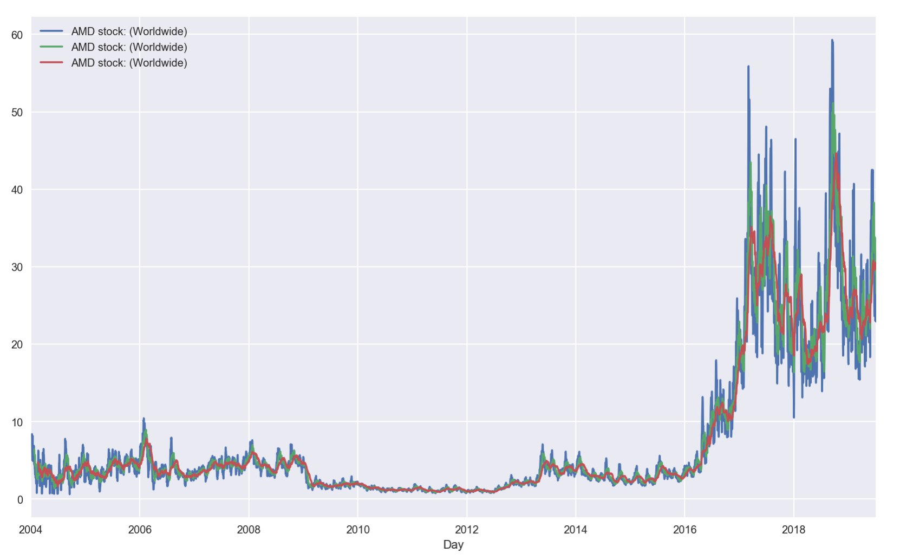
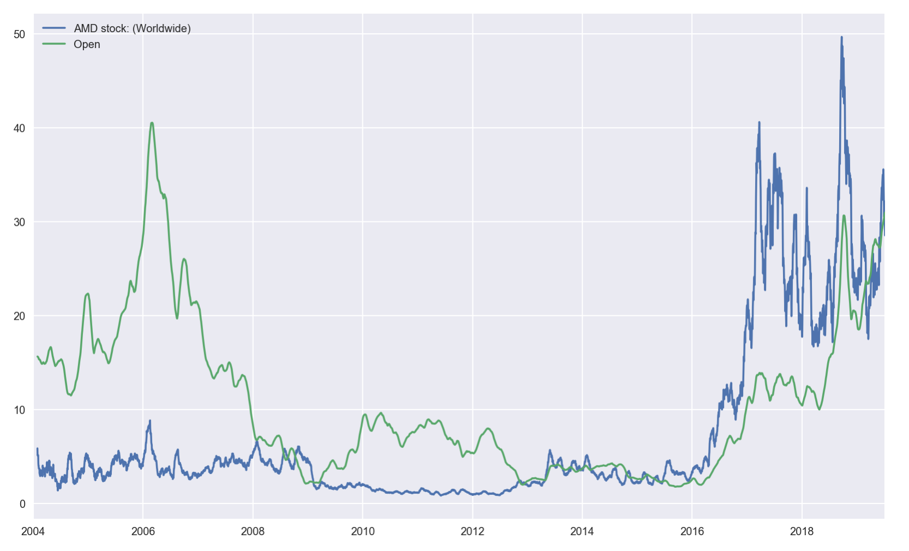

# DailyTrends 6.0

[](https://pepy.tech/project/dailytrends)

A lightweight API to get **full-range daily** Google Trends data. Solves the problem of getting only monthly-based data for large time series. No login required.

## Installation

```bash
pip install DailyTrends
```

Or with [uv](https://docs.astral.sh/uv/):

```bash
uv add DailyTrends
```

## Quick Start

```python
from DailyTrends import collect_data

data = collect_data("AMD stock", start="2004-01-01", end="2024-07-06",
                    geo="", save=False, verbose=False)
```

```python
data.info()
# <class 'pandas.core.frame.DataFrame'>
# DatetimeIndex: 7493 entries, 2004-01-01 to 2024-07-06
# Freq: D
# ...
```

- The returned DataFrame is datetime-indexed and ready for storage/analysis.
- `end` defaults to `"TODAY"`.
- `start` defaults to `"2004-01-01"`.
- `geo` defaults to `""` (worldwide). Use country codes like `"US"`, `"DE"`.

### Plotting

```python
ax = data.rolling(10).mean().plot()
data.rolling(25).mean().plot(ax=ax)
data.rolling(50).mean().plot(ax=ax)
```



### Multiple Queries

```python
data = collect_data(["Intel", "AMD"], start="2004-01-01", end="TODAY",
                    geo="DE", save=False, verbose=False)
```

### Combine with Your Own Data

```python
import pandas as pd

price_data = pd.read_csv("price_data.csv")
merged = pd.merge(price_data, data, left_index=True, right_index=True)
merged[["AMD stock: (Worldwide)", "Open"]].rolling(30).mean().plot()
```



## Development

This project uses [uv](https://docs.astral.sh/uv/) for dependency management.

```bash
# Clone and set up
git clone https://github.com/le0x99/DailyTrends.git
cd DailyTrends
uv sync

# Run tests
uv run pytest -v

# Run linter
uv run ruff check .

# Build the package
uv build
```

## Disclaimer

This API is *not* supported by Google and is for experimental purposes only.
